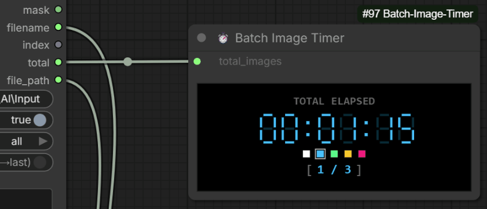

# ⏱️ ComfyUI Batch Image Timer
**Version: v0.1.1**

A specialized custom node for ComfyUI designed to focus on **batch image processing workflows**, providing a **real-time 7-segment LED display timer** to accurately track execution duration, progress, and performance during bulk image generation, dataset preparation, and image-to-image loop workflows.

---

## 📌 Where to Find It in ComfyUI
After installation, you can find this node by right-clicking on the canvas, navigating to **utils** / **batch** (or using the search bar and typing **`Batch Image Timer`**).

---

## ✨ Features

* 🎯 **Dedicated Batch Image Focus**: Tailored specifically for bulk image processing pipelines, sequential loading loops, and image-to-image batch tasks.
* 📺 **7-Segment LED UI**: Retro digital clock design rendered directly on the canvas node.
* 🎨 **Interactive Palette & Theme Persistence**: Click-to-change display color scheme (White, Blue, Green, Yellow, Pink). Your color choice is automatically saved inside the **Workflow JSON** (per-workflow persistence without affecting global settings).
* ⏱️ **Accurate Batch Timing**: Seamlessly measures time spent across multiple batch iterations.
* 📊 **Live Progress Counter & States**: Displays real-time progress `[ Current / Total ]` and clear execution lifecycle states:
  * `[ READY ]`: Initial state before execution.
  * `[ CANCEL ]`: Triggered when the user clicks ComfyUI's red **Cancel / Interrupt** button.
  * `[ ERROR ]`: Triggered automatically when the workflow encounters an exception or execution error from upstream nodes.
* ⏸️ **Interactive Pause & Resume**: Hover over the counter area to toggle `[ PAUSE ]` / `[ RESUME ]`. 
  > **⚠️ Semantic Note on Pause:** Pausing **only freezes the UI time ticking**. It does *not* pause or delay the actual backend workflow execution. It is designed to let you exclude personal away-time (e.g., breaks or interruptions) from the final elapsed time statistics.
* 🔗 **Auto Batch Count Sync**: Connect `total_images` directly to batch loaders (e.g., *Sequential Image Loader*, *ComfyUI-BatchFolderTools*) to automatically update image counts without manual input.

---

<p align="center">
  <br>
  <sub>*Hover over the counter to Pause/Resume, and click LED digits to reset.*</sub>
</p>

---

## 📦 Installation

> **Note:** This node relies strictly on native web standard components and ComfyUI API events. No external Python dependencies or `requirements.txt` are required.

### Method 1: Via ComfyUI-Manager (Recommended)
1. Open ComfyUI and click on **Manager** in the menu.
2. Select **Custom Nodes Manager**.
3. Search for `ComfyUI Batch Image Timer`.
4. Click **Install** and restart your ComfyUI.

### Method 2: Manual Installation (Git Clone)
1. Navigate to your ComfyUI `custom_nodes` directory:
   ```bash
   cd ComfyUI/custom_nodes
   ```
2. Clone this repository:
   ```bash
   git clone https://github.com/hermankwan/ComfyUI-Batch-Image-Timer
   ```
3. Restart your ComfyUI instance.

---

## 🚀 How to Use & Interactive Controls

1. Add **Batch Image Timer** to your batch image workflow graph.
2. Link your total image count to the `total_images` input.
3. Click **Queue Prompt** to start processing your image batches.

### 🖱️ Canvas Interactions
* **Pause / Resume**: Hover over the bottom counter area while running. Click `[ PAUSE ]` to freeze the timer, and click `[ RESUME ]` to continue.
* **Manual Reset**: Click directly on the 7-segment LED time digits at any time to reset the elapsed clock back to `00:00:00`.
* **Theme Swatches**: Click any color block below the digits to change the LED glow color instantly.

---

## 📋 Changelog

### v0.1.1
* Added interactive hover-to-pause (`[ PAUSE ]` / `[ RESUME ]`) functionality.
* Fixed multi-batch time jumping / rebound bugs by decoupling frontend ticks from backend absolute timestamps.
* Implemented workflow-scoped theme color persistence.
* Standardized font sizing and color isolation for progress counters (`x / y`).

### v0.1.0
* Initial release focused on batch image workflow timing.

---

## 📄 License

This project is licensed under the MIT License - see the [LICENSE](LICENSE) file for details.
