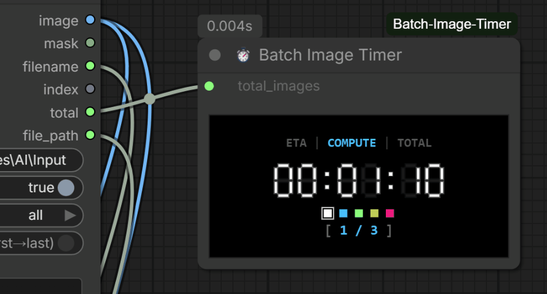

# ⏱️ ComfyUI Batch Image Timer
**Version: v0.2.0**

A specialized custom node for ComfyUI designed to focus on **batch image processing workflows**, providing a **real-time 7-segment LED display timer** to accurately track the total execution duration across sequential loops and bulk image generation pipelines.

---

## 📌 Where to Find It in ComfyUI
After installation, you can find this node by right-clicking on the canvas, navigating to **utils/timer** (or using the search bar and typing **`Batch Image Timer`**).

---

## ✨ Features

* 🎯 **Dedicated Batch Image Focus**: Tailored specifically for bulk image processing pipelines, sequential loading loops (e.g., *Sequential Image Loader*), and image-to-image batch tasks.
* 📺 **7-Segment LED UI**: Retro digital clock design rendered directly on the canvas node.
* 🎨 **Interactive Palette & Theme Persistence**: Click-to-change display color scheme (White, Blue, Green, Yellow, Pink). Your color choice is automatically saved inside the **Workflow JSON** (per-workflow persistence).
* ⏱️ **Macro-Level Accurate Timing**: Unlike native node timers, this timer measures the **entire duration** of a batch process—from the first image starting to the very last image completing—without resetting between iterations.
* 🟢 **Dynamic Visual Status Feedback**: The progress counter `[ X / Y ]` changes color based on the workflow state:
  * ⚪ **Gray (`[ READY ]`)**: Idle, waiting for execution.
  * 🔵 **Blue**: Workflow running.
  * 🟢 **Green (`[ Y / Y ]`)**: Workflow completed successfully.
  * 🟡 **Yellow (`[ INTERRUPT ]`)**: Workflow interrupted by the user.
  * 🔴 **Pink (`[ ERROR ]`)**: Workflow encountered an error and stopped.
* ⏸️ **Absolute Timer Independence**: Click the LED digits to pause/resume, or double-click to reset. 
  > **⚠️ Semantic Note on Interaction:** Pausing **only freezes the UI time ticking**. It does *not* pause the backend workflow, nor does it stop the progress counter from updating. It is designed to let you exclude personal away-time from the final stats.
* 🔗 **Auto Batch Count Sync**: Connect `total_images` directly to batch loaders (e.g., *Sequential Image Loader*, *ComfyUI-BatchFolderTools*) to automatically update image counts without manual input.
* 🛡️ **Multi-Workflow Isolation**: Open multiple workflows in the same browser session. The timer states are perfectly isolated per workflow to prevent cross-contamination.

---

<p align="center">
  <br>
  <sub>*Click LED digits to Pause/Resume, double-click to reset, and click swatches to change colors.*</sub>
</p>

---

## 📦 Installation

> **Note:** This node relies strictly on native web standard components and ComfyUI API events. No external Python dependencies or `requirements.txt` are required.

### Method 1: Via ComfyUI-Manager (Recommended)
1. Open ComfyUI and click on **Manager** in the menu.
2. Select **Custom Nodes Manager**.
3. Search for `ComfyUI-Batch-Image-Timer`.
4. Click **Install** and restart your ComfyUI.

### Method 2: Manual Installation (Git Clone)
1. Navigate to your ComfyUI `custom_nodes` directory:
   ```bash
   cd ComfyUI/custom_nodes
   ```
2. Clone this repository:
   ```bash
   git clone https://github.com/hermankwan/ComfyUI-Batch-Image-Timer
   ```
3. Restart your ComfyUI instance.

---

## 🚀 How to Use & Interactive Controls

1. Add **Batch Image Timer** to your workflow graph.
2. Link your total image count to the `total_images` input (or leave it at `1` for native tensor batches).
3. Click **Queue Prompt** to start processing.

### 🖱️ Canvas Interactions
* **Single Click (Pause/Resume)**: Click anywhere on the 7-segment LED time digits to freeze or continue the timer. (The cursor will change to a pointer).
* **Double Click (Reset)**: Double-click the LED digits to reset the clock back to `00:00:00`. 
  * If the workflow is currently running, the timer will restart from zero immediately.
  * If the workflow is idle, the clock will remain at `00:00:00`.
* **Theme Swatches**: Click any of the 5 color blocks below the digits to change the LED glow color instantly.

---

## 💡 How It Works & `total_images` Principles

To ensure accurate time tracking and clean progress stats, **Batch Image Timer** distinguishes between ComfyUI's native tensor batching and sequential image-by-image processing loops:

### 1. Native Tensor Batching (`batch_size = N` in KSampler / Latent)
* **Behavior**: When you set `batch_size = N` in a Latent node, ComfyUI processes all $N$ images in parallel within a **single Prompt execution cycle**.
* **Setting Rule**: Keep `total_images = 1` (default).
* **Explanation**: The timer tracks the total execution time for the entire tensor batch as 1 unit of work. The counter will display `[ 1 / 1 ]` and turn green upon completion.

### 2. Sequential / Iterative Batching (e.g., Sequential Image Loaders)
* **Behavior**: Workflows that process images iteratively (one-by-one over multiple independent Prompt execution cycles).
* **Setting Rule**: Set `total_images = N` (or connect it directly from your batch loader node).
* **Explanation**: The timer will aggregate the total time across all iterations. The counter will update from `[ 1 / N ]` to `[ N / N ]`, tracking progress without resetting the clock between images.

---

## 📋 Changelog

### v0.2.0 (Major Architecture Refactor)
* **Complete Codebase Rewrite**: Refactored into a modular ES Modules architecture.
* **Batch Tracking Logic**: Fixed counting/resetting issues with Sequential Loaders. Added robust termination fallbacks for interrupted queues.
* **UI/UX Overhaul**: Redesigned node layout, fixed window resizing conflicts, and introduced dynamic color feedback for statuses (Ready/Running/Complete/Error/Interrupt).
* **State Isolation**: Timer interactions (Pause/Reset) are now fully decoupled from the progress counter. Added multi-workflow isolation.

### v0.1.1
* Added interactive hover-to-pause functionality.
* Fixed multi-batch time jumping / rebound bugs.
* Implemented workflow-scoped theme color persistence.

### v0.1.0
* Initial release focused on batch image workflow timing.

---

## 📄 License

This project is licensed under the MIT License - see the [LICENSE](LICENSE) file for details.
